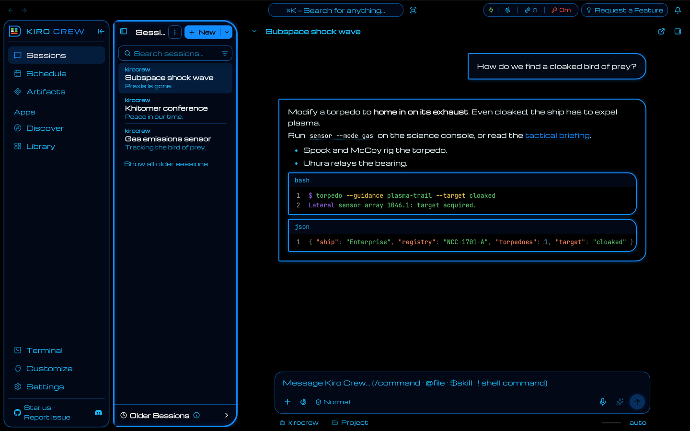
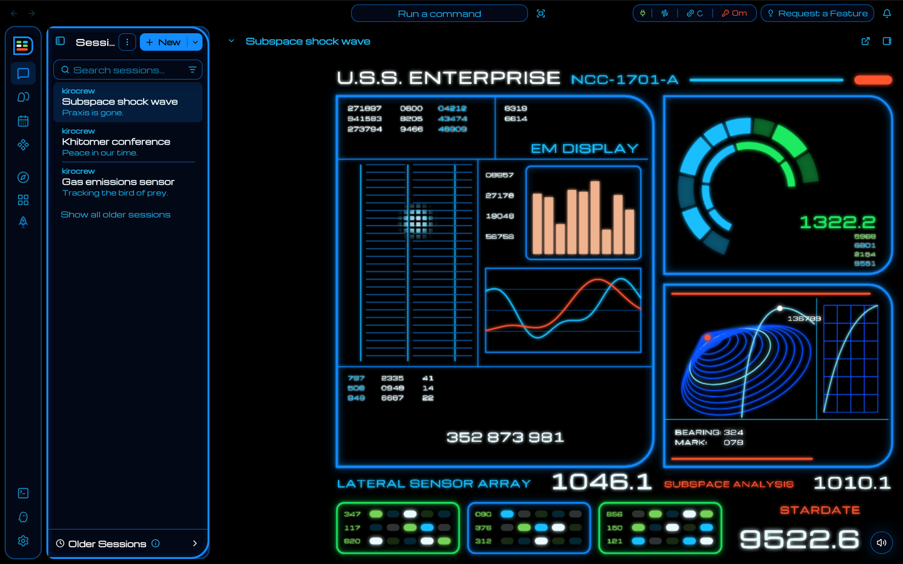
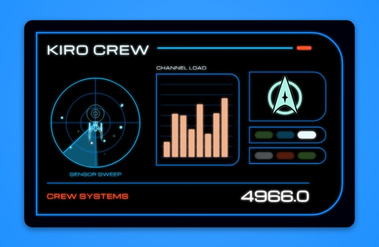
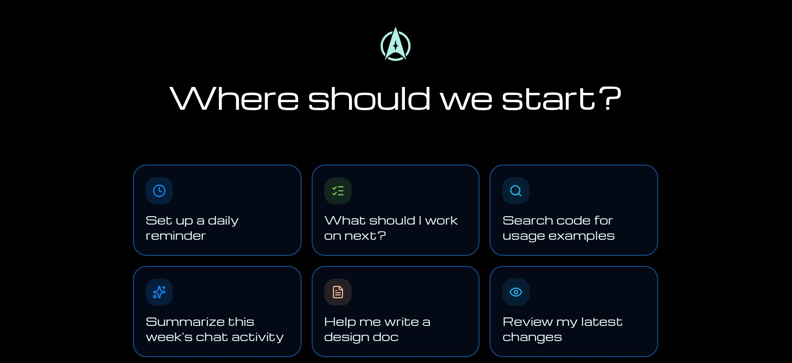
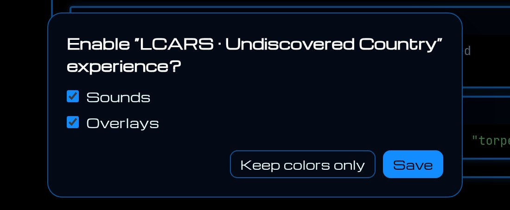

# Kiro Crew theme: LCARS · Undiscovered Country

An unofficial Kiro Crew theme modeled on the Enterprise-A and Excelsior displays in *Star Trek VI: The Undiscovered Country* (1991), by Michael Okuda's scenic art team.

These screens sit between the movie era and LCARS: Okuda-style panels, but framed in electric blue with Microgramma type, not the TNG pastels.

- **Look:** black glass in electric-blue frames that are square on the left and rounded on the right, with their bloom. White type, sky-blue secondary text, green data, red-orange labels.
- **Light mode:** the same as dark. The film has no light screens.
- **Type:** Michroma, a free face in the Microgramma style. The film's monitors use Microgramma Extended Bold ("SUBSPACE ANALYSIS", "LATERAL SENSOR ARRAY"). The letter shapes match; the film's type is heavier.
- **Thinking indicator:** console pills lighting in turn.
- **Welcome mark:** the movie-era Starfleet arrowhead over its ring, in the pale mint of Kirk's quarters display, on a new chat's welcome screen.
- **Screensaver:** after 15 minutes with no key press, click, scroll or touch, a bank of the film's console screens in their blue frames: "U.S.S. ENTERPRISE NCC-1701-A", the "EM DISPLAY" with its stepping bar graph and moving traces, a segmented status ring, "SUBSPACE ANALYSIS" with a ripple running through its rings, lit console pills, and "STARDATE 9522.6" (Kirk's first log in the film). Press a key or click to dismiss it; the click does not reach the app. The dashboard's nav, session list and chat header stay on top, so the screens fill the area to their right. It does not run when the OS is set to reduce motion, and it stops after 30 minutes.
- **Desktop splash:** while the desktop app waits for its gateway, a console screen in the blue frame: a sensor sweep with the Enterprise-A at its centre, a bar graph, the movie-era Starfleet arrowhead in its ring as on Kirk's quarters display, and lit pills. It holds still when the OS asks for reduced motion.
- **Insignia:** the browser tab shows the same arrowhead.
- **Code:** code blocks, diffs and the file viewer use the `github-dark-default` scheme (blue, red-orange and green) in both modes, so code stays readable on the black glass.
- **Sounds:** short console blips when the theme turns on or off, when a reply arrives, on notifications, and when an approval waits. Original sounds made in code (`tools/sounds.py`), shaped after the film's early-1990s consoles: crisp, buzzy blips with a short echo. None is taken from the film. They stay silent under reduced motion and while sounds are muted.

Choosing this theme turns the screensaver on. The first time you pick it, Kiro Crew asks whether to play its sounds. Turn either off later under Settings → Display → Theme → Experience (Overlays for the screensaver, Sounds for the sounds).

Needs Kiro Crew 0.13.0 or newer; older versions refuse the pack.

Pick System under Settings → Display → Font Family to keep the OS font.

| Chat | Screensaver | Desktop splash | Welcome mark | First pick |
|---|---|---|---|---|
|  |  |  |  |  |

## The three LCARS packs

| Repo | Film |
|---|---|
| [kirocrew-theme-lcars-wrath-of-khan](https://github.com/leozhad/kirocrew-theme-lcars-wrath-of-khan) | *Star Trek II: The Wrath of Khan* (1982) |
| This one | *Star Trek VI: The Undiscovered Country* (1991) |
| [kirocrew-theme-lcars-first-contact](https://github.com/leozhad/kirocrew-theme-lcars-first-contact) | *Star Trek: First Contact* (1996) |

## Install

1. Open Settings → Display → Theme.
2. Under **Install Theme**, choose **GitHub** and paste `https://github.com/leozhad/kirocrew-theme-lcars-undiscovered-country`.
3. Install, then pick **LCARS · Undiscovered Country** in the Theme list.

To update, install the same URL again.

From a browser that is not on the gateway's machine (a phone, say), use a zip instead: on GitHub choose **Code → Download ZIP**, then in Install Theme set **Theme source** to **Zip file** and pick that file. Kiro Crew finds the pack inside the zip's one top-level folder.

## Use your own sounds

The sounds are WAV files in `audio/`, named in `audio/manifest.json`: `activate` and `deactivate` (the theme turns on or off), `received` (a reply arrives), `notify` (notifications) and `approval` (an approval waits). To play your own, clone or unzip this repo, replace any of those files with a sound of your own under the same name, and install that folder (**Local folder**) or a zip of it. Kiro Crew accepts WAV, MP3 or OGG; if you change the extension, change `src` in `audio/manifest.json` to match. Keep each file under 512 KB. Kiro Crew stops a sound after its `maxDuration` (at most 5 s for `activate`, 1 s for `received`, 2 s for the others). Do not edit the installed copy: reinstalling replaces it.

## Film evidence

Colours were measured on [TrekCore](https://movies.trekcore.com/gallery/) Blu-ray screencaps: the film's hue and saturation, with brightness set for contrast (body text at least 7:1, secondary text and status colours at least 4.5:1). The frames are not in this repo.

Source: 4K remaster Blu-ray (2022). Scenic art: Michael Okuda's team ([Memory Alpha](https://memory-alpha.fandom.com/wiki/Michael_Okuda)).

| Colour | Frame | What it is | Film hue, sat |
|---|---|---|---|
| frame | 477 | electric-blue screen frames (line cores, value at least 200) | 208°, 0.92 |
| sky | 469 | sky-blue rules in Kirk's quarters display | 200°, 0.92 |
| cyan | 111 | pale cyan highlights | 193°, 0.53 |
| data | 635 | green data blocks on the bridge consoles | 105°, 0.56 |
| deepgreen | 635 | dark green pills | 138°, 0.89 |
| label | 111 | red-orange "SUBSPACE ANALYSIS" label | 10°, 0.78 |
| bars | 477 | orange bar graph on "EM DISPLAY" | 21°, 0.38 |
| emblem | 469 | Starfleet arrowhead in a ring on Kirk's quarters display | 169°, 0.27 |
| subspace | 111 | deep-blue nested ellipses on "SUBSPACE ANALYSIS" (screensaver) | 223°, 0.96 |
| label | 111 | the red-orange rules on the same screen: the label colour again (screensaver) | 10°, 0.81 |
| sky, deepgreen | 635 | the segmented status ring, blue and green parts: the existing sky and dark green (screensaver) | 199°, 0.95; 143°, 0.81 |

Screensaver text, each read off an enlarged frame or checked on Memory Alpha:

| Text | Source |
|---|---|
| "EM DISPLAY", "LATERAL SENSOR ARRAY", "1046.1" | frame 477 |
| "1322.2" | frame 635, beside the segmented ring |
| "SUBSPACE ANALYSIS", "1010.1", "BEARING:", "MARK:" | frame 111 |
| "U.S.S. ENTERPRISE", "NCC-1701-A", "STARDATE 9522.6" | Kirk's first captain's log in the film, aboard the Enterprise-A ([Memory Alpha](https://memory-alpha.fandom.com/wiki/Star_Trek_VI:_The_Undiscovered_Country)). The opening log, 9521.6, is Sulu's aboard the Excelsior. |

Not used: the line under the arrowhead in frame 469 (it looks like Kirk's name and the ship's, but is too blurred to read), the ring's label in frame 635, and "DATA BANK WEAPONS RECORD" (partly hidden).

Type: Microgramma Extended Bold on the monitors: "SUBSPACE ANALYSIS" and "1010.1" (111), "EM DISPLAY" and "LATERAL SENSOR ARRAY 1046.1" (477), "COMMANDER SCHEDULE" and "COOLANT UNIT" (469). The first guess, Helvetica Ultra Compressed as on TNG, was wrong. As with *The Wrath of Khan*, Michroma matches the letter shapes but is lighter.

Shapes: thin blue frames that are square on one side and rounded on the other (469, 477, 499), with visible bloom. Inside, small rounded pills (635).

Insignia: the movie-era Starfleet arrowhead over a ring, tip above it and legs below, on Kirk's quarters display (469). The splash draws it in the measured pale mint.

Not from the film: the terminal's magenta slot. These screens show no magenta.

## Credits and licenses

See [`LICENSE.txt`](LICENSE.txt). The pack, its artwork and its sounds are MIT; the sounds are original, synthesized in code, and inspired by the films. The font is under the SIL Open Font License 1.1.

Unofficial fan art. Star Trek, LCARS, the Starfleet and Federation insignia, the ships, and related marks belong to their owners (CBS Studios / Paramount). Not affiliated with or endorsed by them. This repo ships no film images and no film audio.
