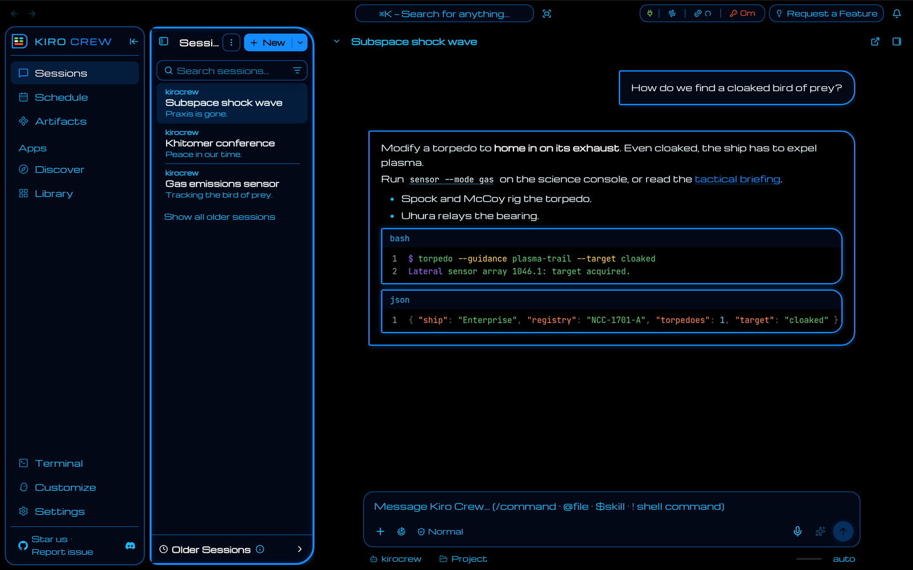

# Kiro Crew theme: LCARS · Undiscovered Country

An unofficial Kiro Crew theme modeled on the Enterprise-A and Excelsior displays in *Star Trek VI: The Undiscovered Country* (1991), by Michael Okuda's scenic art team.

These screens sit between the movie era and LCARS: Okuda-style panels, but framed in electric blue with Microgramma type, not the TNG pastels.

- **Look:** black glass in electric-blue frames that are square on the left and rounded on the right, with their bloom. White type, sky-blue secondary text, green data, red-orange labels.
- **Light mode:** the same as dark. The film has no light screens.
- **Type:** Michroma, a free face in the Microgramma style. The film's monitors use Microgramma Extended Bold ("SUBSPACE ANALYSIS", "LATERAL SENSOR ARRAY"). The letter shapes match; the film's type is heavier.
- **Thinking indicator:** console pills lighting in turn.

Pick System under Settings → Display → Font Family to keep the OS font.

| Chat |
|---|
|  |

## The three LCARS packs

| Repo | Film |
|---|---|
| [kirocrew-theme-lcars-wrath-of-khan](https://github.com/leozhad/kirocrew-theme-lcars-wrath-of-khan) | *Star Trek II: The Wrath of Khan* (1982) |
| This one | *Star Trek VI: The Undiscovered Country* (1991) |
| [kirocrew-theme-lcars-first-contact](https://github.com/leozhad/kirocrew-theme-lcars-first-contact) | *Star Trek: First Contact* (1996) |

## Install

1. Open Settings → Display → Theme.
2. Under **Install Theme**, choose **GitHub** and paste `https://github.com/leozhad/kirocrew-theme-lcars-undiscovered-country`.
3. Install, then pick **LCARS · Undiscovered Country** in the Theme list.

To update, install the same URL again.

## Film evidence

Colours were measured on [TrekCore](https://movies.trekcore.com/gallery/) Blu-ray screencaps: the film's hue and saturation, with brightness set for contrast (body text at least 7:1, secondary text and status colours at least 4.5:1). The frames are not in this repo.

Source: 4K remaster Blu-ray (2022). Scenic art: Michael Okuda's team ([Memory Alpha](https://memory-alpha.fandom.com/wiki/Michael_Okuda)).

| Colour | Frame | What it is | Film hue, sat |
|---|---|---|---|
| frame | 477 | electric-blue screen frames (line cores, value at least 200) | 208°, 0.92 |
| sky | 469 | sky-blue rules in Kirk's quarters display | 200°, 0.92 |
| cyan | 111 | pale cyan highlights | 193°, 0.53 |
| data | 635 | green data blocks on the bridge consoles | 105°, 0.56 |
| deepgreen | 635 | dark green pills | 138°, 0.89 |
| label | 111 | red-orange "SUBSPACE ANALYSIS" label | 10°, 0.78 |
| bars | 477 | orange bar graph on "EM DISPLAY" | 21°, 0.38 |

Type: Microgramma Extended Bold on the monitors: "SUBSPACE ANALYSIS" and "1010.1" (111), "EM DISPLAY" and "LATERAL SENSOR ARRAY 1046.1" (477), "COMMANDER SCHEDULE" and "COOLANT UNIT" (469). The first guess, Helvetica Ultra Compressed as on TNG, was wrong. As with *The Wrath of Khan*, Michroma matches the letter shapes but is lighter.

Shapes: thin blue frames that are square on one side and rounded on the other (469, 477, 499), with visible bloom. Inside, small rounded pills (635).

Not from the film: the terminal's magenta slot. These screens show no magenta.

## Credits and licenses

See [`LICENSE.txt`](LICENSE.txt). The pack is MIT. The font is under the SIL Open Font License 1.1.

Star Trek and LCARS are trademarks of CBS Studios / Paramount. This is unofficial fan work with no affiliation, and it ships no film images.
